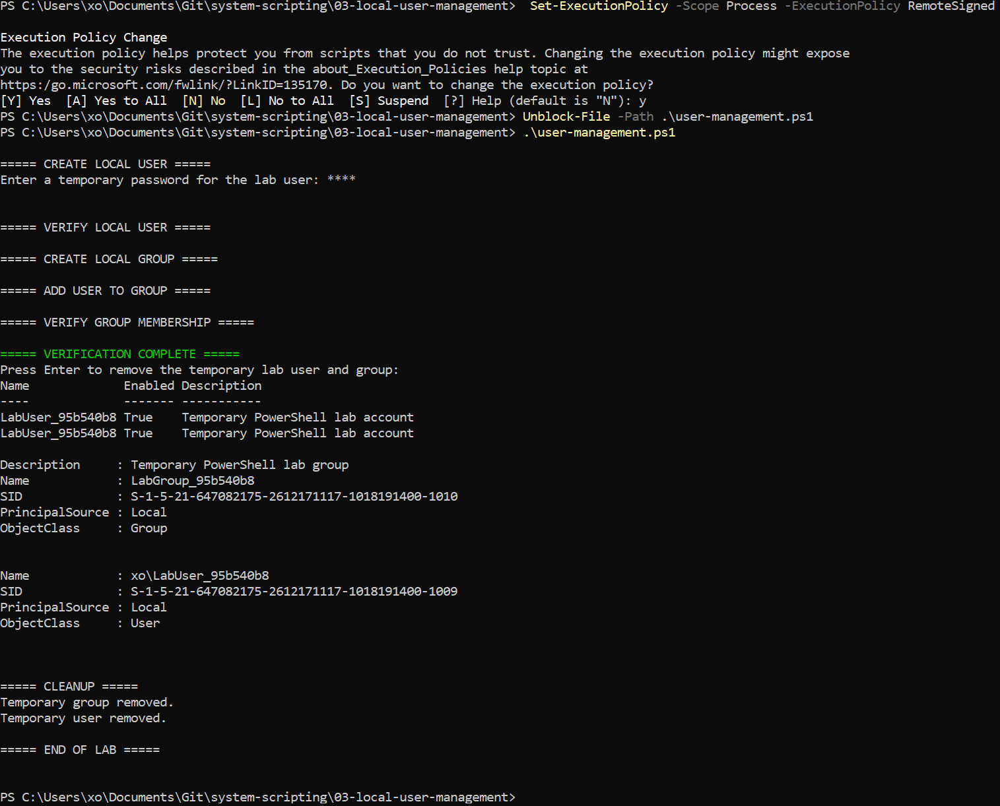

# Windows Local User & Group Management

## Overview

This project demonstrates Windows local user and group administration using PowerShell.

The objective was to automate the creation, configuration, verification, and removal of local user accounts and security groups.

The script was developed as part of my practical experience with Windows system administration and PowerShell automation.

> **Note:** This project is an updated implementation of a PowerShell lab completed as part of the CNET 334 System Scripting course at Centennial College. The script was reconstructed based on the original lab objectives, with additional safeguards and automated cleanup. The implementation was successfully tested on Windows.

## Technologies

- Windows PowerShell
- Windows Local Users and Groups
- PowerShell LocalAccounts Module
- Windows Security
- PowerShell Scripting

## Objectives

- Create a local Windows user account
- Create a local security group
- Add a user to a local group
- Verify user account properties
- Verify group membership
- Automate the removal of temporary resources
- Implement basic safety checks for administrative operations

## PowerShell Commands

| Command | Purpose |
|---------|---------|
| `New-LocalUser` | Create a local Windows user |
| `Get-LocalUser` | Retrieve local user information |
| `New-LocalGroup` | Create a local security group |
| `Add-LocalGroupMember` | Add a user to a group |
| `Get-LocalGroupMember` | Verify group membership |
| `Remove-LocalUser` | Delete a local user |
| `Remove-LocalGroup` | Delete a local group |
| `Read-Host -AsSecureString` | Securely request a password |

## Implementation

### 1. Administrator Privileges

The script first verifies that PowerShell is running with administrator privileges.

Administrative permissions are required to manage Windows local users and groups.

If the session is not elevated, the script stops before making changes.

### 2. Local User Creation

A temporary local Windows user account is created using `New-LocalUser`.

The script generates a unique username to avoid conflicts with existing accounts.

The account password is entered securely using `Read-Host -AsSecureString`.

### 3. Local Group Creation

A temporary local security group is created using `New-LocalGroup`.

Unique group names help prevent conflicts with existing Windows groups.

### 4. Group Membership Configuration

The temporary user is added to the newly created group using `Add-LocalGroupMember`.

Group membership is then verified using `Get-LocalGroupMember`.

### 5. Automated Cleanup

After verification, the script removes the temporary local user and group.

A `try/finally` block ensures that cleanup is attempted even if an error occurs during execution.

Only resources created by the current script execution are targeted for removal.

## Security Considerations

The implementation includes several safety measures:

- Administrator privilege verification
- Unique temporary usernames and group names
- Secure password input
- Verification of created resources
- Automated cleanup of temporary accounts and groups
- No modification of existing Windows accounts

These measures reduce the risk of unintended changes during testing.

## Verification

The reconstructed script was successfully executed in an elevated Windows PowerShell session.

| Verification | Result | Evidence |
|--------------|--------|----------|
| Administrator privileges | Passed | Script execution |
| Local user creation | Passed | PowerShell output |
| Local user verification | Passed | PowerShell output |
| Local group creation | Passed | PowerShell output |
| Group membership configuration | Passed | PowerShell output |
| Group membership verification | Passed | PowerShell output |
| Temporary group removal | Passed | PowerShell output |
| Temporary user removal | Passed | PowerShell output |

### Execution Results

The following screenshot demonstrates the successful creation, verification, and cleanup of temporary Windows user and group resources.



## How to Run

1. Open Windows PowerShell as Administrator.

2. Navigate to the project directory.

3. Execute the script:

```powershell
.\user-management.ps1
```

4. Enter a temporary password when prompted.

5. Review the user and group information displayed in PowerShell.

6. Press Enter to initiate cleanup.

**Note:** Execute this script only on a Windows system where you are authorized to manage local accounts and groups.

## Key Takeaways

This project strengthened my understanding of Windows user and group administration through PowerShell.

I gained practical experience creating and managing local accounts, configuring group membership, and verifying administrative operations.

Reconstructing the original lab also provided an opportunity to improve the implementation by introducing administrator privilege checks, unique resource naming, and automated cleanup.

These skills are directly applicable to IT support, Windows system administration, and infrastructure management.

