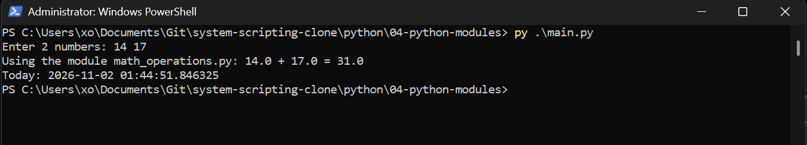

# Python Modules — Arithmetic Operations & Datetime

## Overview

This project demonstrates the fundamentals of Python modules, functions, and code reuse.

The objective was to create a custom Python module containing an arithmetic function, import it into a separate program, accept user input, and display the current date and time.

This project was completed as part of the CNET 334 System Scripting course at Centennial College.

> **Note:** This implementation is adapted from my original Lab 5 submission. The source code was recovered from my submitted lab documentation and renamed for clarity while preserving the original functionality.

## Technologies

- Python 3
- Python Standard Library
- `datetime` module
- User-defined Python modules
- PyCharm
- Windows PowerShell

## Project Structure

```text
04-python-modules/
├── main.py
├── math_operations.py
├── README.md
└── screenshots/
    └── execution-result.png
```

## Objectives

- Create a reusable Python function
- Organize code into separate modules
- Import a user-defined module
- Accept and process user input
- Convert string inputs into numeric values
- Perform arithmetic operations
- Retrieve and display the current date and time

## Implementation

### 1. Creating a Custom Python Module

The `math_operations.py` file contains a function named `add()`.

```python
def add(a, b):
    print(a, '+', b, '=', a + b)
```

The function accepts two arguments, calculates their sum, and displays the result.

Separating this function into its own module demonstrates how Python code can be organized and reused across multiple programs.

### 2. Importing the Module

The main program imports the custom module using:

```python
import math_operations
```

The function is then executed using dot notation:

```python
math_operations.add(a, b)
```

This demonstrates the relationship between a module and the functions defined inside it.

### 3. Processing User Input

The program requests two numbers from the user:

```python
a, b = input("Enter 2 numbers: ").split()
a, b = float(a), float(b)
```

The `input()` function reads the user's response as a string.

The `split()` method separates the two values, and `float()` converts them into numbers that can be used in calculations.

Using `float()` also allows the program to process decimal values.

### 4. Working with Datetime

The program imports Python's built-in `datetime` module:

```python
import datetime
```

The current date and time are retrieved using:

```python
date = datetime.datetime.now()
print("Today:", date)
```

This demonstrates how standard-library modules provide functionality without requiring additional dependencies.

## Verification

The program was successfully executed in Windows PowerShell using Python 3.

### Test Results

| Verification | Result |
|--------------|--------|
| Python script execution | Passed |
| Custom module import | Passed |
| User input processing | Passed |
| String-to-float conversion | Passed |
| Arithmetic calculation | Passed |
| Current date and time retrieval | Passed |
| Program completion | Passed |

### Execution Example

Input:

```text
Enter 2 numbers: 14 17
```

Output:

```text
Using the module math_operations.py: 14.0 + 17.0 = 31.0
Today: 2026-11-02 01:44:51.846325
```

The following screenshot shows the successful execution of the program.



## Troubleshooting & Debugging

During the original lab, I investigated several common Python programming mistakes.

### Input Conversion

The `split()` method separates strings but does not convert their data types.

For example, using `split(float)` is incorrect.

The correct approach is to split the input first and then convert the values:

```python
a, b = input("Enter 2 numbers: ").split()
a, b = float(a), float(b)
```

### Printing vs. Returning Values

The `add()` function uses `print()` to display the result rather than returning it.

Therefore, the following statement would display the calculation followed by `None`:

```python
print(math_operations.add(a, b))
```

This happens because functions without an explicit `return` statement return `None`.

The correct approach for this implementation is to call the function directly:

```python
math_operations.add(a, b)
```

### Module Imports

A custom Python module must be located somewhere Python can find it.

For this project, `main.py` and `math_operations.py` are stored in the same directory, allowing the import to work without additional configuration.

## How to Run

### Requirements

- Python 3
- Windows, Linux, or macOS
- No external Python packages required

### Execution

1. Clone the repository:

```bash
git clone https://github.com/younes-mouhri/system-scripting.git
```

2. Navigate to the project directory:

```bash
cd system-scripting/python/04-python-modules
```

3. Execute the program:

```bash
python main.py
```

On Windows, the Python launcher can also be used:

```powershell
py main.py
```

4. Enter two numbers separated by a space.

5. Review the arithmetic result and current date/time displayed in the terminal.

## Key Takeaways

This lab introduced me to modular programming in Python and demonstrated how functions can be organized into reusable modules.

I practiced importing user-defined and standard-library modules, processing user input, converting data types, and using Python's `datetime` functionality.

I also gained a better understanding of the difference between printing a value and returning a value from a function.

These concepts provide a foundation for developing more advanced Python scripts and automation tools.
